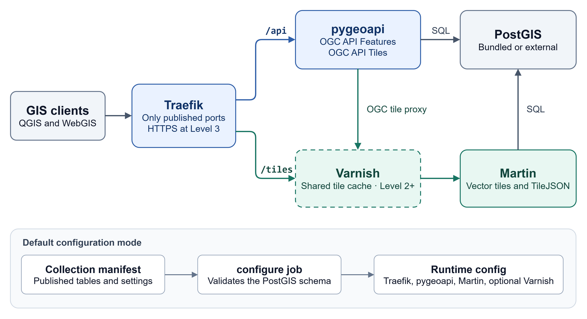

# GeoREST API

Serve PostGIS data to QGIS and WebGIS clients through OGC API Features, OGC API Tiles, and MapLibre-compatible vector tiles.

## Quickstart

Clone the repository and copy `.env.example` to `.env`. Use `Copy-Item .env.example .env` in PowerShell or `cp .env.example .env` in a POSIX shell. With Docker running, start the demo.

```sh
docker compose up -d --build --wait
```

- [OGC API landing page](http://localhost/api)
- [Feature collections](http://localhost/api/collections)
- [Martin catalog](http://localhost/tiles/catalog)
- [Demo TileJSON](http://localhost/tiles/demo_points)

The demo publishes read-only data on loopback. Stop it with `docker compose down`. To use your own data, [configure external PostGIS](docs/configuration.md#external-postgis) and name the datasets in a collection manifest.

## Architecture



At Level 1, Traefik and pygeoapi send tile requests directly to Martin. At Levels 2 and 3, Varnish caches eligible tile responses. Requests with credentials or cookies bypass the shared cache.

[Editable draw.io diagram](docs/architecture.drawio)

## Deployment levels

| Level | Start with | Adds |
|---|---|---|
| 1 · Quickstart | `make up LEVEL=1` | Read-only features and tiles |
| 2 · Cache | `make up LEVEL=2` | Shared vector tile cache with per-collection TTLs |
| 3 · Secure | `make up LEVEL=3` | HTTPS, guarded feature writes, and optional private reads |
| 4 · Roles | Deferred | OIDC and per-collection roles are being evaluated |

See [deployment levels](docs/levels.md) for Compose-only commands, [configuration](docs/configuration.md) for manifests and write setup, and [client examples](docs/webgis-clients.md) for MapLibre, OpenLayers, and QGIS. For an existing deployment, see the [migration guide](docs/migration.md). The [verification notes](docs/VERIFIED.md) record dependency versions and runtime checks.

## License

[MIT](LICENSE)
